# Claude Office

A light, airy, low-poly isometric office that visualizes your Claude Code work.

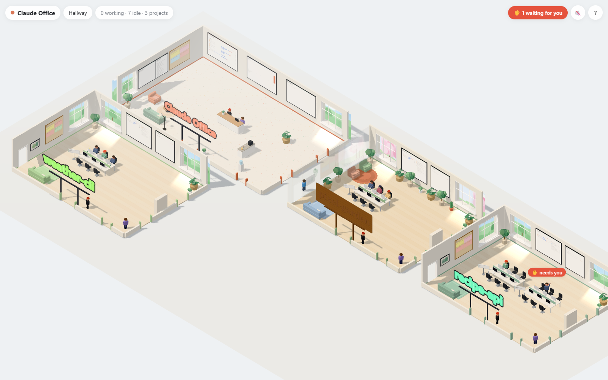

- **Rooms** are projects (git repos; worktrees of the same repo share a room). They grow with their worktrees and only
  shrink once a worktree has been gone for 3 days.
- **Desk pods** are worktrees — the sign shows the checked-out branch. Paper stacks = uncommitted files.
- **Characters** are sessions, dressed by what they're doing (coder, artist, data scientist, writer, tester, devops, researcher, musician).
  Typing = working · sipping coffee = idle · jacket on chair = stepped away · ✋ = needs you · stretching + robot = compacting.
  Small interns appear while subagents run.
- **Mugs → energy cans** pile up as a session's context fills.
- **Speech bubbles** pop up for a few seconds when you walk up to a table or an agent's status changes, then fade.
  Hover an agent to see its bubble again; right-click an agent (or its bubble) to pin the bubble open.
- **Neon signs** over every doorway show the project name. Ask the designer for a different style (neon, marquee,
  brass, wood, chalkboard), colour, font or wording.
- **Dust and cobwebs** collect on desks (and rooms) that haven't been touched in days.
- **Boards**: project + branch boards in every room, a to-do board per project (with a Tree tab: drag to nest and reorder, draw dependency arrows), and in the lobby: office overview,
  usage, efficiency tips, office-wide to-dos and new-furniture approvals.
- **Agents keep the boards up to date themselves.** With the `office-todo` skill installed, your sessions claim the
  to-dos they're working on, split big ones into subtasks, attach notes on what they found, mark items done or
  blocked, and set their own speech bubble. They raise a ✋ only when they need a decision from you.
- **Sessions hear about board changes.** The office hooks add a short note to a session's context when it starts
  (what's open, what it holds) and on later prompts when something it claimed or created changes: an item it waited
  on was unblocked, someone else finished or took it over, or you added work. Nothing is added when nothing changed.
  When a session ends, its claims are marked "session ended" so another session can take them without `--force`.
- **▶ Start a session on an item.** On a project board, ▶ opens a terminal window running `claude` in the worktree
  you pick, with the item already claimed for it. It's an ordinary interactive session: you approve its permissions
  as usual. Before marking its item done, a session leaves a handoff note on every item that waits on it.
- **Checks.** An item can carry a command that proves it is done (`npm test`). Set one in the item's edit row, or a
  session sets one with `office-todo check <id> "..."`. The office only runs a check you approved (your own are
  approved as you type them; one a session set shows an *approve* button), so a well-behaved session can't use
  the board to run commands outside its own permission prompts (see the note on the API under *Sessions starting
  sequences*). Tick *run checks sessions set without asking me* at the top of a project board to drop that step:
  then any session's check runs unapproved. *run* on the item runs it now; its output goes into the background.
- **Permissions of ▶ sessions.** The settings strip at the top of a project board picks the permission mode the
  office starts sessions in: your usual default (no flag), ask me, accept edits, auto, or never ask.
- **Run in sequence.** In the ▶ dialog, tick *then keep going* to have the office work through the item, its
  subtasks and everything that waits on them, one fresh session at a time, up to a cap (default 5, at most 15). A
  board runs up to 15 sequences at once, as long as no two share an open item. Each starts the
  next item only once the current one is done, its session's turn is over and its check passed. It stops and asks
  for you (✋ at that session's desk) if an item is blocked, released, reopened or taken over, its session ended,
  its check failed (the item goes back to in progress, with the output attached) or isn't approved. No Claude
  session orchestrates it, so waiting costs no tokens. Finished sessions' windows stay open; close them when you
  like. *Stop* starts nothing new but lets running steps finish; press it again to stop right away.
- **Parallel sequences.** Set *at once* above 1 and items that don't wait on each other (a fan-out) run side by side,
  up to 4. Each gets its own git worktree and branch (`.claude/worktrees/office-<id>-…`, kept out of `git status`)
  made from the chosen worktree's HEAD; its session is told to commit there. When it is done and verified the office
  merges the branch back into the chosen worktree, runs the item's check again on the merged result (two branches
  can each pass and still break each other once combined) and removes the worktree, and only then can what waits on
  it start, so a join item sees every branch's work. A merge conflict, a check that fails after merging (the merge is
  taken back), uncommitted work in the step's worktree or uncommitted changes in the chosen worktree put the item
  back to in progress (its branch is kept) and stop new starts. On Windows a step's folder can't be deleted while its
  terminal is open; the office removes it once you close the window. Things to know:
  - **Pick a worktree nobody works in.** Merges land in the chosen worktree (it must be on a branch), so files change
    under any session or editor working there, and your own uncommitted edits there stop the run. A separate
    worktree on an integration branch is the safest base; the dialog shows how many live sessions each one has.
  - **Every step is an interactive session.** Four at once means approving permission prompts in four windows.
    Pre-approving commands lets a run go on without you, but these sessions are not sandboxed, so approve with care.
  - **Step worktrees live inside the repo** (like Claude Code's own). Tools that walk folders in the base (jest,
    eslint, tsc, IDE indexers) may find a copy of the code per step, e.g. jest's "duplicate module" errors; exclude
    `.claude/worktrees/` in their config if they do.
- **Sessions starting sequences.** A session can plan a chain on the board and ask for it to run with
  `office-todo run <id> [--max N] [--parallel N]` (the skill teaches how). The *Sequences* setting under a project
  board decides: *only me* (refused), *sessions may ask* (the default: the plan waits on the board with Start /
  Dismiss and the session's desk shows ✋) or *sessions may start them*. Sessions that a sequence started can never
  start one, and sequences started by sessions share a daily cap of 20 sessions (`sessionRunDailyCap` in
  `~/.claude/office/settings.json`). These settings decide how well-behaved sessions ask; they are not a security
  boundary. The office's API can't tell its own page from any other program on your machine, so a session that
  runs `curl` or a script against it could start a run, approve a check or edit the board files, whatever the
  setting says. The skill tells sessions never to call the API, and the step check that sessions are
  sequence-started relies on environment variables they could change. Keep reviewing shell commands as usual.
- **Results.** Sessions can post charts, tables, images and short notes (test runs, benchmarks, training metrics)
  with `office-todo results …`, partial results included. A small screen with a live sparkline goes up on the
  agent's desk and a "📊 View results" tab sits above its speech bubble; click either to open the results window.
  A session can point the office at a metrics file its script keeps appending to, and the chart redraws as the
  file grows. Results stay listed in the project's panel after the session ends.
- **The designer** by each door redecorates the room on request (background `claude -p` on your subscription). It
  picks from a catalog and can model missing pieces in Blender; new pieces wait for your approval in the lobby.
  It can read the room's project folder and reuse its art: game sprites become chunky voxel 3D models
  (`sprite_voxels`, sprite-sheet aware), and other images become framed prints, canvases, cut-outs or floor decals.
- **Ask a colleague**: click any agent to ask a separate agent that has read that session's transcript.
- **The office administrator** (purple, with a clipboard) in each room briefs you on what all of that room's agents are doing;
  the office manager behind the lobby desk covers every project.
- **Windows** let daylight into every room. The designer can change the view outside (meadow, mountains, lake, city,
  sunset city, beach, desert, snow, cherry blossom, rain, night sky, space, underwater…).
- Only projects with activity in the last 3 days get a room (`roomMaxAgeDays`).

## Screenshots

| | |
|---|---|
| 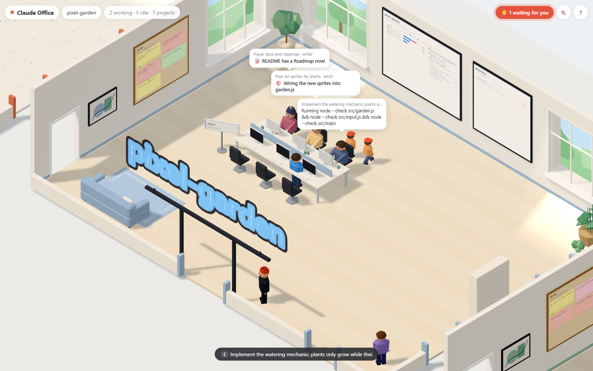 | 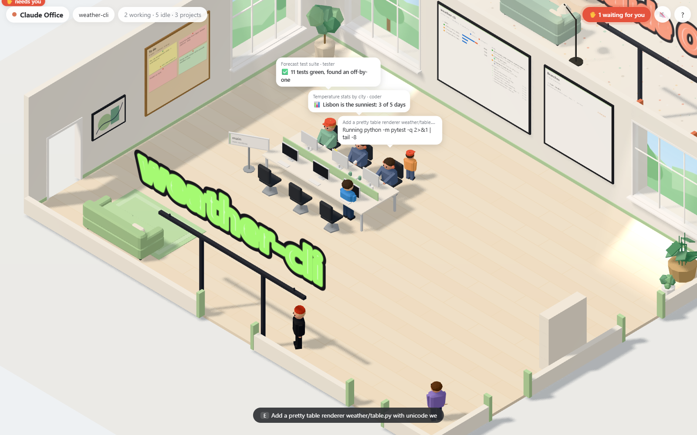 |
| **Working agents** — interns appear while subagents run | **Speech bubbles** — what each agent is up to |
| 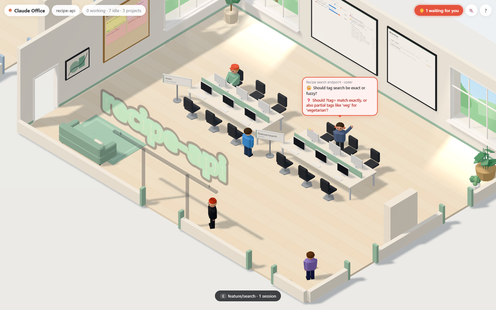 | 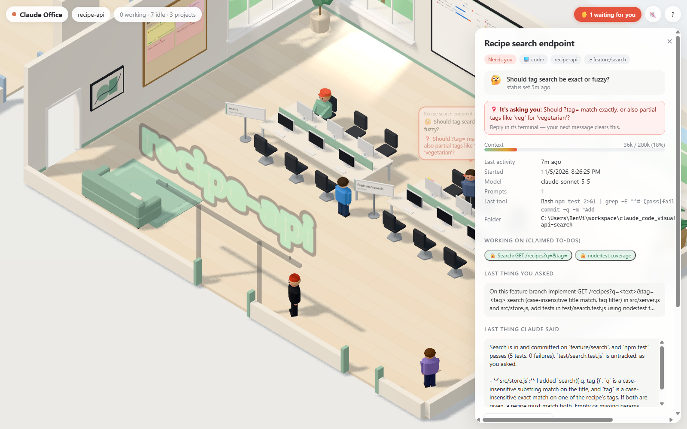 |
| **Worktrees and ✋ needs you** — one pod per branch | **Session panel** — click any agent |
| 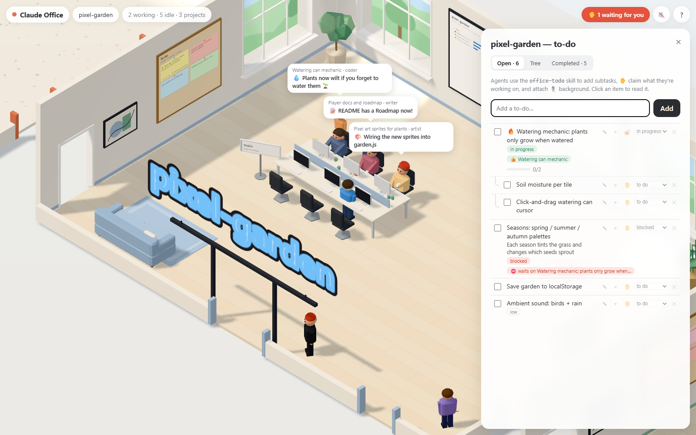 | 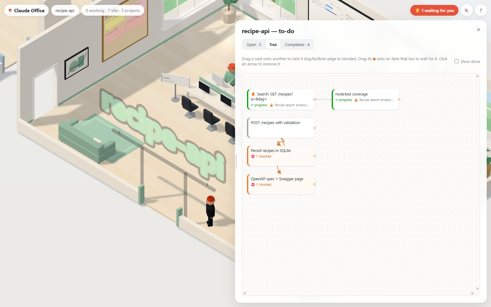 |
| **To-do board** — subtasks, claims, priorities | **Tree tab** — drag to nest, draw dependencies |
| 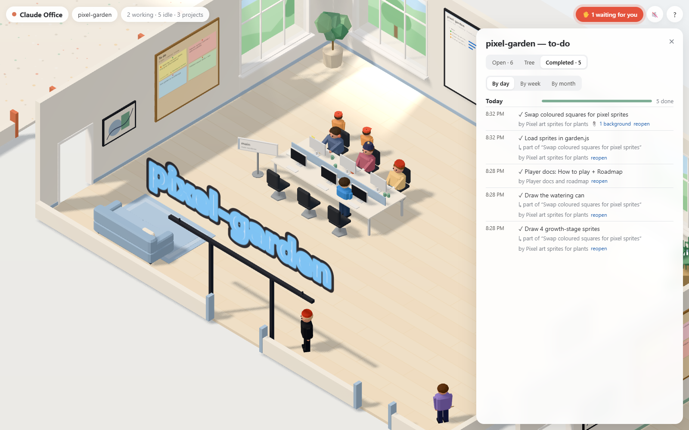 | 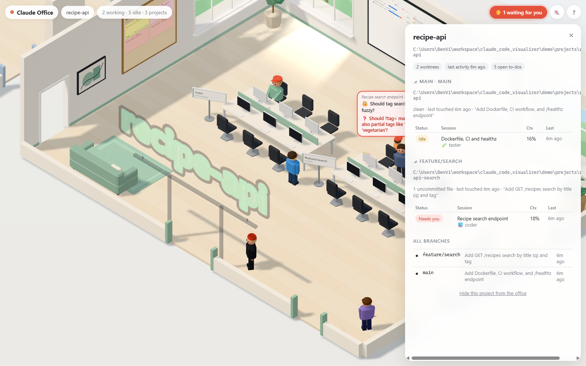 |
| **Completed** — by day, week or month | **Branches board** — worktrees, sessions, commits |
| 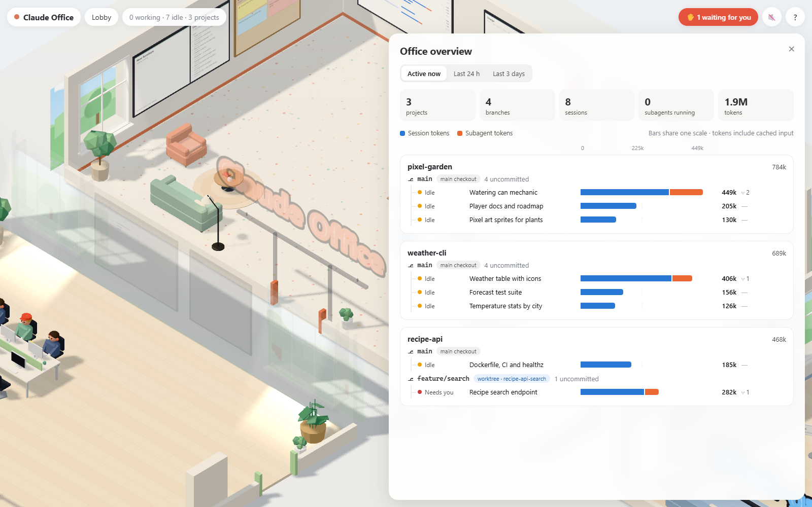 | 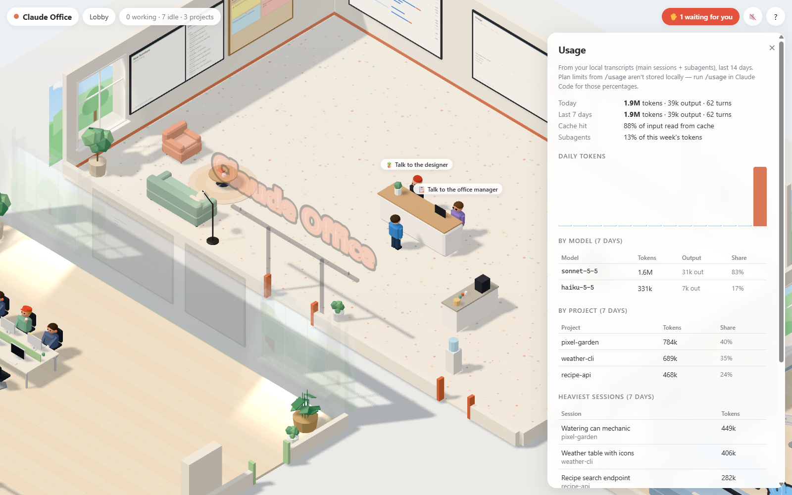 |
| **Office overview** — every project at a glance | **Usage** — tokens by day, model, project, session |
| 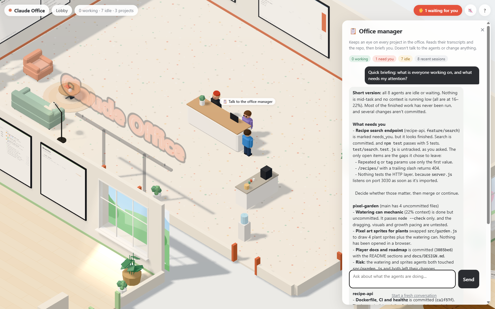 | 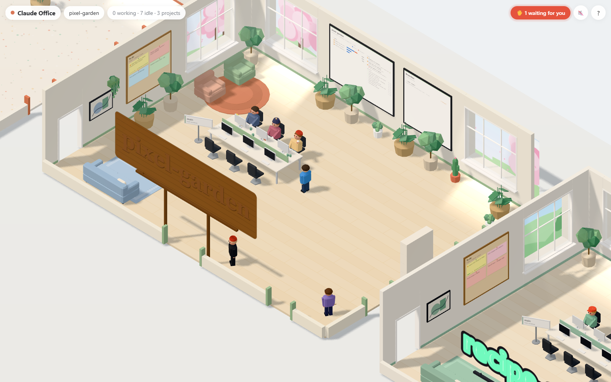 |
| **Office manager** — a briefing across projects | **The designer** — redecorates on request |
| 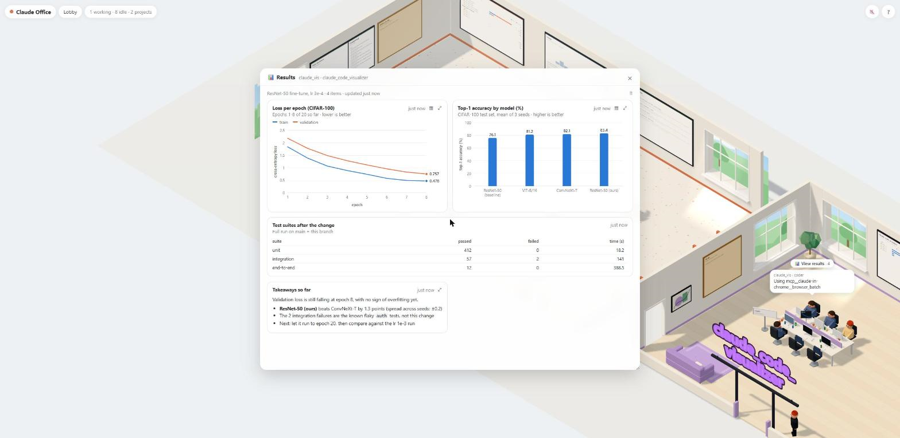 | |
| **Results** — charts and notes a session posted | |

## Requirements

- **Node.js 20+** and **git** on your PATH
- **Claude Code**, signed in. The office reads its transcripts, and the in-office agents run `claude -p`.
- *Optional:* **Blender**, only needed when the designer models new furniture. You can install it any time; the
  office picks it up without a restart.

Developed and tested on **Windows 11**. macOS and Linux should work (paths are resolved from your home directory
and Blender/Claude are looked up in the usual places and on PATH) but haven't been tested yet — issues welcome.

## Install

Let Claude Code do it:

```bash
git clone https://github.com/BenVizena/claude-office
cd claude-office
claude
```

Accept the "trust this folder" prompt (that's what lets Claude Code load the repo's setup skill), then type
**`/setup-office`** or just ask it to set things up. It checks your Node and git, installs everything below (explaining each step first),
offers to install Blender, starts the office and makes sure it's working.

Or by hand:

```bash
npm install
npm run setup        # installs the hooks and the office-todo skill, then checks everything
npm start            # http://localhost:4777
```

Next time, just run `npm start` in this folder. `npm run open` does the same in a new terminal window (and does
nothing if the office is already running); Claude Code uses it, through the `/start-office` skill, so the office
doesn't stop with the session that started it. `npm run status` checks the install; `npm run uninstall` removes
the hooks and the skill.

Setup installs two things outside this folder:

- **Hooks** for instant status (permission prompts, stop/end, compaction).
- **The `office-todo` skill** in `~/.claude/skills/office-todo`, which lets your sessions read and update the to-do
  boards, set their status bubble and post results.

The hooks go in your **global** `~/.claude/settings.json` (a copy is saved as `settings.json.office-backup`).
The hook only forwards a few fields (session id, event name, tool name, cwd, a short message) to the local server and
always exits immediately, so it never slows down or blocks Claude Code — even when the office isn't running.
The hook script is copied to `~/.claude-office/` (and refreshed when you pull a new version), so it keeps working if
you move or delete the clone.

The `office-todo` skill runs the to-do CLI from inside the clone. **If you move the folder, run `npm run setup` again
from the new location; before deleting it, run `npm run uninstall`.**

## Costs and permissions

The office itself is free: it only reads files. These features start **background Claude Code sessions
(`claude -p`) that count against your own Claude plan**, and only when you ask for them:

| Feature | Model setting | Tools it gets |
|---|---|---|
| Designer (redecorate a room) | `decorModel` | Read/Write/Edit in its own workspace, the furniture scripts, and **read access to the room's project folder** (`--add-dir`) so it can reuse its art. Edits and writes in the project folder are denied (`--disallowedTools "Edit(<project>/**)" "Write(<project>/**)"`) |
| Ask a colleague | `chatModel` | Read-only: Read, Grep, Glob, `git log/diff/status/show` |
| Office administrator / manager | `chatModel` | Read-only, as above, plus the listing forms of `git branch` (`-a`, `-r`, `--list`, `--show-current`) and `git worktree list` |

Each one gets only the tools it needs (`--tools`), and Bash only for the listed commands (`--allowedTools`).
`git --output=<file>` is denied for all of them, since `git log/diff/show` would otherwise write files with it.
The colleague and the administrator run in the default permission mode, so anything not listed is refused. The
designer runs with `--permission-mode acceptEdits` so it can edit its own workspace.

One caveat: when Blender is installed, the designer models furniture by writing a Blender Python script and running
it through `make-item.mjs`. That script is ordinary Python, so the permission rules above don't limit what it can do.

## Controls

WASD / arrows to walk (Shift to hurry), click the floor to walk there (paths go through doors), E or click to interact,
wheel to zoom, 0–9 to jump between rooms, M for sound, Esc to close panels. Right-click furniture to move/resize it, or an
agent to pin its status bubble.

## Data

There is no database. Sessions are read from Claude Code's own transcripts in `~/.claude/projects` and from git, and
kept in memory. What the office itself saves is plain JSON/Markdown:

- `~/.claude/office/` — `settings.json`, `decor/` (room layouts, stored relative to the walls so they survive rooms
  resizing), `room-sizes.json`, `todos/` (to-do boards), `catalog/` (furniture), `status/` (agents' status lines),
  `results/` (posted results, one file per run, plus copies of posted images)
- `~/.claude-office/staff/` — workspaces for the background agents (kept outside `~/.claude`, which Claude Code protects from edits)
- `~/.claude-office/office-hook.mjs` — the installed hook

Results that `watch` a file aren't copied: the office stores the file's path and reads it from where it is whenever
it changes, so the chart stops updating if the file is moved or deleted. Agents can clear their results with
`office-todo results clear`, and you can delete a run from the results window.

Delete `~/.claude/office/` and `~/.claude-office/staff/` to reset the office. To remove it entirely, run
`npm run uninstall` first, then delete `~/.claude/office/` and `~/.claude-office/`.

Nothing leaves your machine except the `claude -p` calls above. The server binds to 127.0.0.1 only, rejects requests
whose `Host` isn't `localhost`/`127.0.0.1` (DNS-rebinding protection) and refuses cross-site requests. It has no
login: any program running as you can call it, Claude sessions with shell access included.
Set `OFFICE_PORT` to use a port other than 4777.

Settings (`~/.claude/office/settings.json`): `roomMaxAgeDays`, `sessionMaxAgeDays`, `showBackgroundSessions`,
`hiddenProjects`, `pinnedProjects`, `chatModel`, `decorModel`, `blenderPath`, `claudePath`.
`claudePath` is detected on first run; edit it if detection picked the wrong one (it may also point at Claude Code's
`cli.js`, which is then run with node). Leave `blenderPath` empty to find Blender automatically: it's looked for again
while the office runs, so installing Blender later works without a restart. Until then the designer sticks to the
catalog and flat art, and tells you when a request would need Blender.

Usage numbers come from transcripts (main sessions + subagents). The plan-limit percentages shown by `/usage`
are not stored locally, so they aren't on the board.

## Tests

```bash
npm test
```

Runs the suite in `test/` with Node's built-in test runner (no extra dependencies; needs Node 21+ for the file glob).
It covers the to-do boards, board news, results, transcript scanning and status, pricing, the office layout math,
the `office-todo` CLI end to end, and the hook. Each test file points the home directory at a temporary folder
(`test/helpers/home.js`) and deletes it afterwards, so tests never touch your real `~/.claude` data, and they don't
need the office to be running.

## License

MIT — see [LICENSE](LICENSE).
