# Claude Office

A light, airy, low-poly isometric office that visualizes your Claude Code work.

It runs as a web page, or **headless**: the same to-do boards, statuses and sequences with no web page and no open
port, shown as an isometric wireframe in your terminal. And the sessions it starts on board items don't have to be
Claude Code: [Pi](https://pi.dev) is built in, and any other coding agent can be added as a command. See
[Headless office and the terminal view](#headless-office-and-the-terminal-view) and
[Choosing a coding agent](#choosing-a-coding-agent).

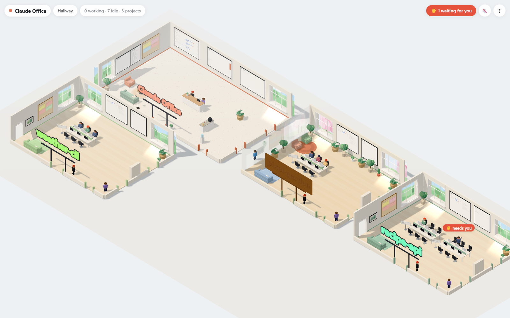

- **Rooms** are projects (git repos; worktrees of the same repo share a room). They grow with their worktrees and only
  shrink once a worktree has been gone for 3 days.
- **Desk pods** are worktrees — the sign shows the checked-out branch. Paper stacks = uncommitted files.
- **Characters** are sessions, dressed by what they're doing (coder, artist, data scientist, writer, tester, devops, researcher, musician).
  Typing = working · sipping coffee = idle · jacket on chair = stepped away · ✋ = needs you · stretching + robot = compacting.
  Small interns appear while subagents run.
- **Mugs → energy cans** pile up as a session's context fills.
- **Speech bubbles** pop up for a few seconds when you walk up to a table or an agent's status changes, then fade.
  Hover an agent to see its bubble again; right-click an agent (or its bubble) to pin the bubble open.
- **Neon signs** over every doorway show the project name. Ask the designer for a different style (neon, marquee,
  brass, wood, chalkboard), colour, font or wording.
- **Dust and cobwebs** collect on desks (and rooms) that haven't been touched in days.
- **Boards**: project + branch boards in every room, a to-do board per project (with a Tree tab: drag to nest and reorder, draw dependency arrows), and in the lobby: office overview,
  usage, efficiency tips, office-wide to-dos and new-furniture approvals.
- **Agents keep the boards up to date themselves.** With the `office-todo` skill installed, your sessions claim the
  to-dos they're working on, split big ones into subtasks, attach notes on what they found, mark items done or
  blocked, and set their own speech bubble. They raise a ✋ only when they need a decision from you.
- **Sessions hear about board changes.** The office hooks add a short note to a session's context when it starts
  (what's open, what it holds) and on later prompts when something it claimed or created changes: an item it waited
  on was unblocked, someone else finished or took it over, or you added work. Nothing is added when nothing changed.
  When a session ends, its claims are marked "session ended" so another session can take them without `--force`.
- **▶ Start a session on an item.** On a project board, ▶ opens a terminal window running `claude` (or the coding
  agent you made the default, see *Choosing a coding agent*) in the worktree you pick, with the item already claimed
  for it. It's an ordinary interactive session: you approve its permissions as usual. Before marking its item done, a session leaves a handoff note on every item that waits on it. Tick
  *in a new worktree and branch made from it* to have the office make a fresh worktree for it first
  (`.claude/worktrees/office-<id>-…` inside the one you picked, on branch `office/<id>-…` from its HEAD), so it
  doesn't edit the same files as sessions already there. The session commits on that branch; merging it is up to you.
- **Checks.** An item can carry a command that proves it is done (`npm test`). Set one in the item's edit row, or a
  session sets one with `office-todo check <id> "..."`. The office only runs a check you approved (your own are
  approved as you type them; one a session set shows an *approve* button), so a well-behaved session can't use
  the board to run commands outside its own permission prompts (see the note on the API under *Sessions starting
  sequences*). Tick *run checks sessions set without asking me* at the top of a project board to drop that step:
  then any session's check runs unapproved. *run* on the item runs it now; its output goes into the background.
- **Permissions of ▶ sessions.** The settings strip at the top of a project board picks the permission mode the
  office starts sessions in: your usual default (no flag), ask me, accept edits, auto, or never ask.
- **Run in sequence.** In the ▶ dialog, tick *then keep going* to have the office work through the item, its
  subtasks and everything that waits on them, one fresh session at a time, up to a cap (default 5, at most 15). A
  board runs up to 15 sequences at once, as long as no two share an open item. Each starts the
  next item only once the current one is done, its session's turn is over and its check passed. It stops and asks
  for you (✋ at that session's desk) if an item is blocked, released, reopened or taken over, its session ended,
  its check failed (the item goes back to in progress, with the output attached) or isn't approved. No Claude
  session orchestrates it, so waiting costs no tokens. Finished sessions' windows stay open; close them when you
  like. *Stop* starts nothing new but lets running steps finish; press it again to stop right away.
- **Parallel sequences.** Set *at once* above 1 and items that don't wait on each other (a fan-out) run side by side,
  up to 4. Each gets its own git worktree and branch (`.claude/worktrees/office-<id>-…`, kept out of `git status`)
  made from the chosen worktree's HEAD; its session is told to commit there. When it is done and verified the office
  merges the branch back into the chosen worktree, runs the item's check again on the merged result (two branches
  can each pass and still break each other once combined) and removes the worktree, and only then can what waits on
  it start, so a join item sees every branch's work. A merge conflict, a check that fails after merging (the merge is
  taken back), uncommitted work in the step's worktree or uncommitted changes in the chosen worktree put the item
  back to in progress (its branch is kept) and stop new starts. On Windows a step's folder can't be deleted while its
  terminal is open; the office removes it once you close the window. Things to know:
  - **How steps land** is an office setting on the board (*Parallel steps land as*): a merge commit per step
    (the default), one squashed commit per step (the branch's own commits are dropped), or the step's commits rebased
    onto the chosen worktree and fast-forwarded (linear history). A rebase conflict is aborted like a merge conflict,
    leaving the step's branch as it was.
  - **Pick a worktree nobody works in.** Merges land in the chosen worktree (it must be on a branch), so files change
    under any session or editor working there, and your own uncommitted edits there stop the run. A separate
    worktree on an integration branch is the safest base; the dialog shows how many live sessions each one has.
  - **Every step is an interactive session.** Four at once means approving permission prompts in four windows.
    Pre-approving commands lets a run go on without you, but these sessions are not sandboxed, so approve with care.
  - **Step worktrees live inside the repo** (like Claude Code's own). Tools that walk folders in the base (jest,
    eslint, tsc, IDE indexers) may find a copy of the code per step, e.g. jest's "duplicate module" errors; exclude
    `.claude/worktrees/` in their config if they do.
- **Sessions starting sequences.** A session can plan a chain on the board and ask for it to run with
  `office-todo run <id> [--max N] [--parallel N]` (the skill teaches how). The *Sequences* setting under a project
  board decides: *only me* (refused), *sessions may ask* (the default: the plan waits on the board with Start /
  Dismiss and the session's desk shows ✋) or *sessions may start them*. Sessions that a sequence started can never
  start one, and sequences started by sessions share a daily cap of 20 sessions (`sessionRunDailyCap` in
  `~/.claude/office/settings.json`). These settings decide how well-behaved sessions ask; they are not a security
  boundary. The web office's API can't tell its own page from any other program on your machine, so a session that
  runs `curl` or a script against it could start a run, approve a check or edit the board files, whatever the
  setting says. The headless office has no API, but the same controls exist as `office-todo` commands, which
  refuse to run inside a session only because of environment variables a session could change, and the boards and
  settings are plain files. The skill tells sessions never to do any of that. Keep reviewing shell commands as usual.
- **Results.** Sessions can post charts, tables, images and short notes (test runs, benchmarks, training metrics)
  with `office-todo results …`, partial results included. A small screen with a live sparkline goes up on the
  agent's desk and a "📊 View results" tab sits above its speech bubble; click either to open the results window.
  A session can point the office at a metrics file its script keeps appending to, and the chart redraws as the
  file grows. Results stay listed in the project's panel after the session ends.
- **The designer** by each door redecorates the room on request (background `claude -p` on your subscription). It
  picks from a catalog and can model missing pieces in Blender; new pieces wait for your approval in the lobby.
  It can read the room's project folder and reuse its art: game sprites become chunky voxel 3D models
  (`sprite_voxels`, sprite-sheet aware), and other images become framed prints, canvases, cut-outs or floor decals.
- **Ask a colleague**: click any agent to ask a separate agent that has read that session's transcript.
- **The office administrator** (purple, with a clipboard) in each room briefs you on what all of that room's agents are doing;
  the office manager behind the lobby desk covers every project.
- **Windows** let daylight into every room. The designer can change the view outside (meadow, mountains, lake, city,
  sunset city, beach, desert, snow, cherry blossom, rain, night sky, space, underwater…).
- Only projects with activity in the last 3 days get a room (`roomMaxAgeDays`).

## Screenshots

| | |
|---|---|
| 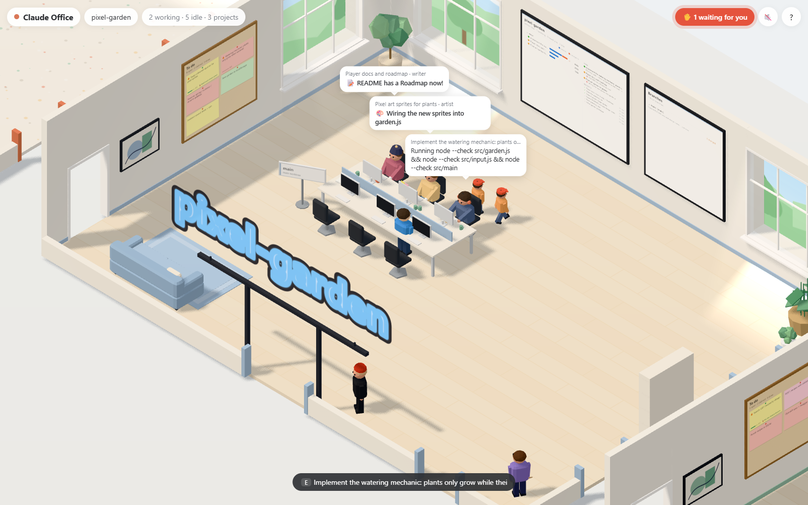 | 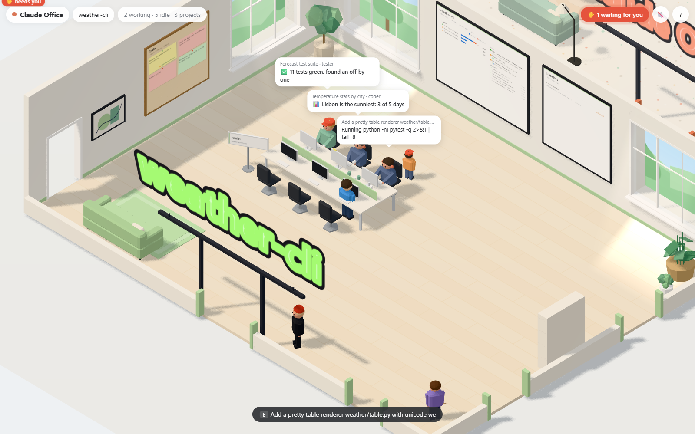 |
| **Working agents** — interns appear while subagents run | **Speech bubbles** — what each agent is up to |
| 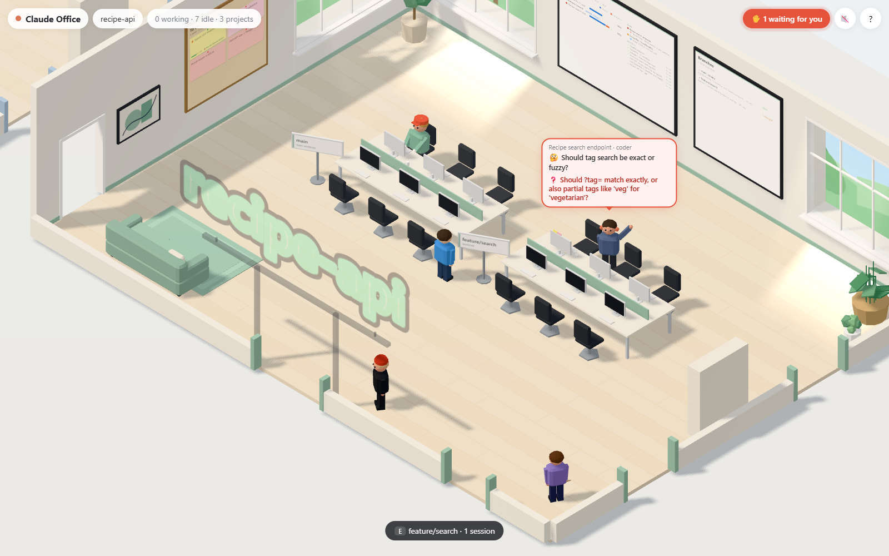 | 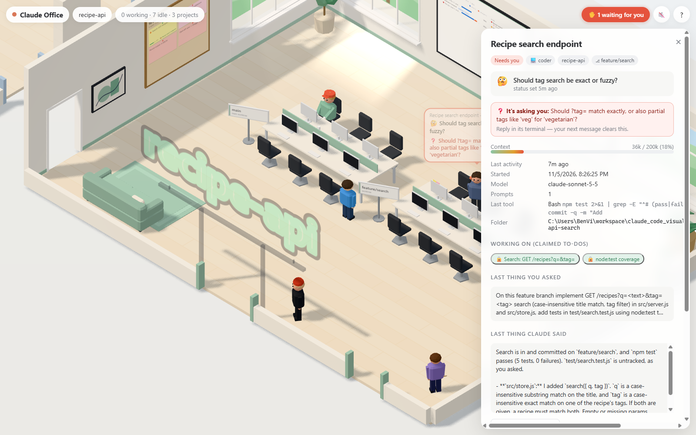 |
| **Worktrees and ✋ needs you** — one pod per branch | **Session panel** — click any agent |
| 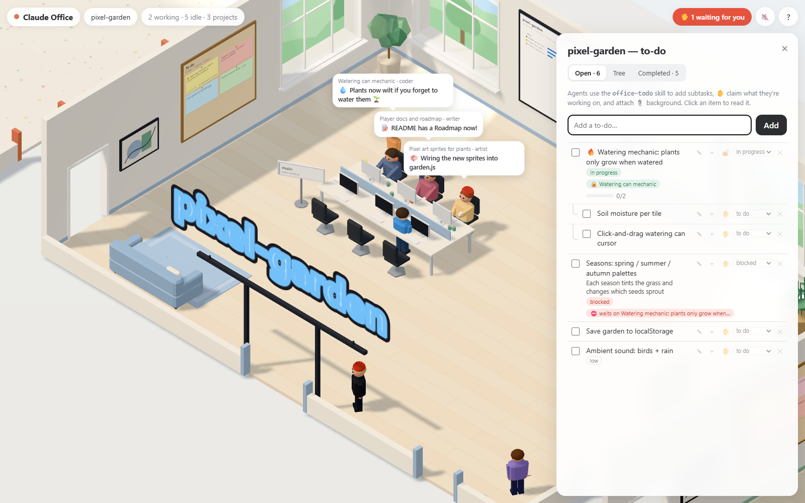 | 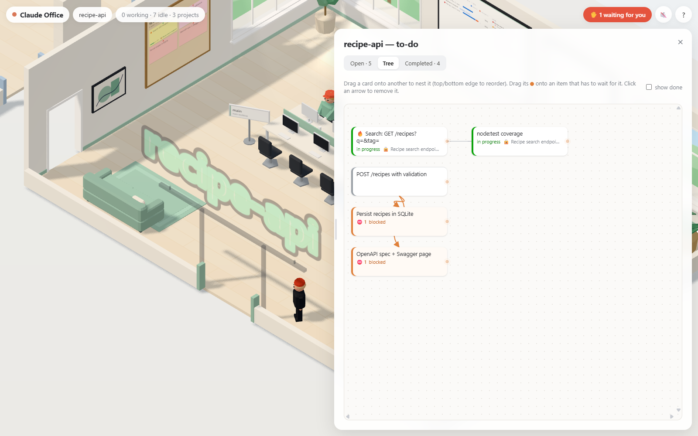 |
| **To-do board** — subtasks, claims, priorities | **Tree tab** — drag to nest, draw dependencies |
| 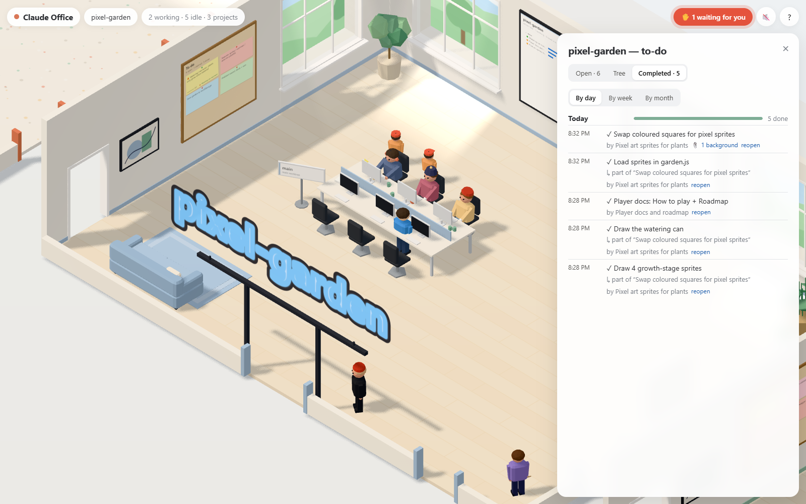 | 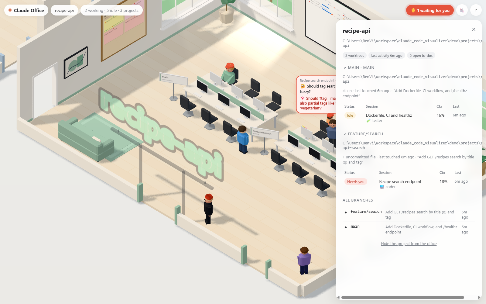 |
| **Completed** — by day, week or month | **Branches board** — worktrees, sessions, commits |
| 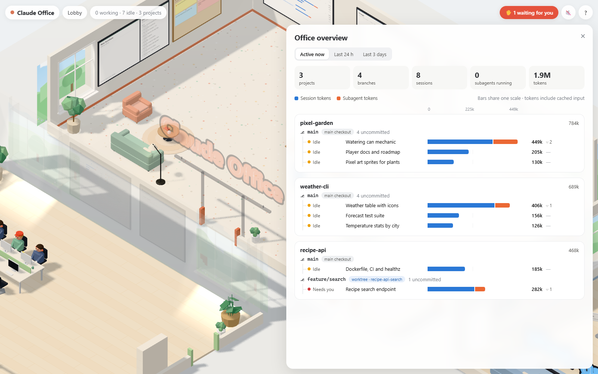 | 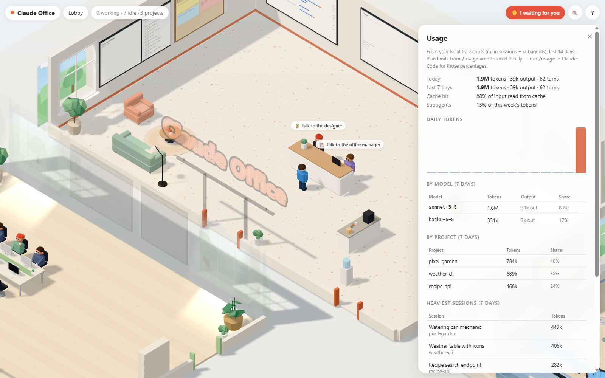 |
| **Office overview** — every project at a glance | **Usage** — tokens by day, model, project, session |
| 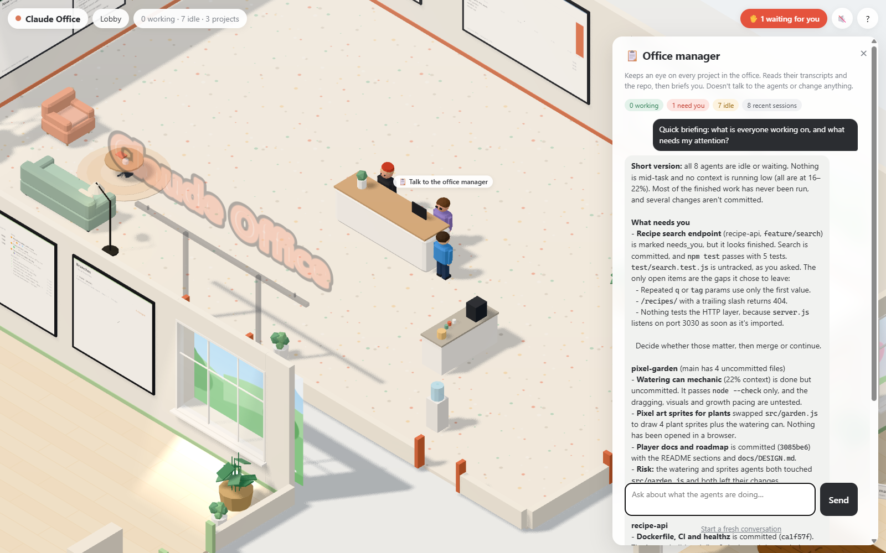 | 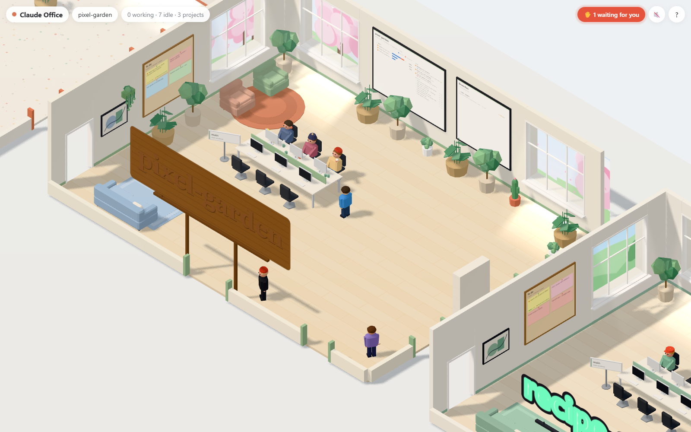 |
| **Office manager** — a briefing across projects | **The designer** — redecorates on request |
| 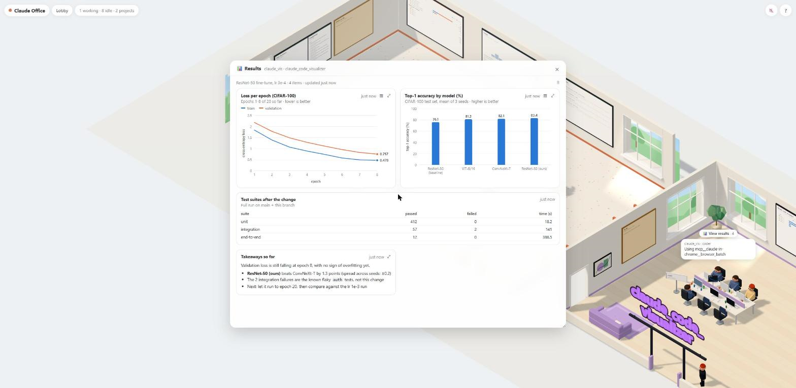 | |
| **Results** — charts and notes a session posted | |

## How the to-do board and sequences work

The bullets above say what you see. This section explains the model underneath: what a board is, how sessions
coordinate through it, how a sequence turns a set of board items into a chain of fresh sessions, how Claude takes
part in all of it, and what that buys you in capability and in tokens.

### The board: shared state that outlives any one session

Every project (a git repo; its worktrees share it) has one board, and there is one office-wide board. A board is a
plain JSON file in `~/.claude/office/todos/`. The server and the `office-todo` CLI both read and write it, taking a
lock file for each write, so the page on the wall, your clicks and any number of sessions all edit the same state.

Each **item** has:

- **A title and a one-line summary.** The title is short and imperative. The summary says why the item matters or
  where it stands. A summary over 200 characters is shortened, and the full text is kept as background.
- **A status**: `todo`, `doing`, `blocked` or `done`, plus a priority.
- **A place in two structures that do different jobs:**
  - **Parent/child** (subtasks, up to 4 levels) says *what is part of what*. A parent is only finished when its
    subtasks are.
  - **Dependencies** (`blockedBy`, the arrows in the Tree tab) say *what has to happen first*. They can cross the
    whole board. An item with an unfinished dependency is blocked automatically. When the last one is done, it goes
    back to `todo` by itself and the sessions following it hear about it. An item you block by hand stays blocked
    until you unblock it.
- **A claim**: which session is working on it. A claim is how two sessions avoid doing the same work. Taking a live
  claim needs `--force`. A claim is *stale*, and anyone may take it, when its session ended, when a ▶ launch never
  started (10 minutes), or when nobody has touched it for 6 hours.
- **Background**: numbered notes, logs and code snippets that sessions or you attach. They are stored separately
  (`todos/details/`), so a board stays small and `list` stays cheap, while `show <id>` gives the full story. Notes
  are never deleted. A stale note is *replaced* or *retired* and kept in the history, so the current picture stays
  accurate without losing the record.
- **A check** (optional): a command that proves the item is done, such as `npm test`. It only runs once you approve
  it, unless you let checks run unapproved.

The board is the **durable memory of the work**. A Claude session's context disappears when it ends or compacts.
What it wrote to the board stays: what it found, what it decided, what is left. The next session starts from that
instead of from nothing.

### How sessions stay in sync with it

Sessions don't poll the board. The office tells them what changed, and only when something changed:

1. **Subscriptions.** A session follows every item it claims or adds, from the moment it does, plus anything it
   `watch`es. Following ends on its own when the item is done or removed, when the claim is gone, or after 5 wake-ups.
   That way an idle session can't be woken forever.
2. **An outbox per session.** The office compares each followed item with how it looked last time and queues news
   when something mattered: it was unblocked, someone else finished it, the claim was taken over, or you added
   work.
3. **Delivery through hooks.** On `SessionStart` the hook adds a few lines to the session's context: how many items
   are open, how many are ready, what this session holds, and claims left behind by ended sessions. On each later
   prompt it adds only news from the outbox. With nothing new, it adds **nothing**: no text, no tokens. The note is
   capped at 6 lines. News leaves the outbox only once the hook confirms it printed it, so a dropped hook means news
   arrives twice, never that it is lost.
4. **`office-todo wait` for idle sessions.** A session that has to wait for another one runs `wait` as a background
   command. It is an ordinary Node process: it uses no tokens while waiting and exits, waking the session, when a
   followed item changes.
5. **Ended sessions let go.** When a session ends, the office marks its claims "session ended", so the next session
   can pick the work up without `--force` and reads the background the previous one left.

### How Claude works with the board

The `office-todo` skill (installed by `npm run setup`) teaches each session how to use the board. In practice a
session:

- **Puts multi-part work on the board before starting.** When you hand it a list (review findings, a plan, several
  fixes), it adds one item per task, then claims and finishes them one at a time, so you can follow progress from
  the office.
- **Claims before it starts** and releases what it gives up, so parallel sessions don't collide.
- **Splits big items** into subtasks and restructures with `move` rather than deleting and re-adding, so ids,
  claims and background survive.
- **Records what matters, briefly**: the root cause, the key log, the decision and why. Stale notes are corrected
  in place with `--replaces` or `--retire`.
- **Adds follow-ups as it notices them** (a bug spotted on the way, a gap, a TODO), with a summary saying why they
  matter.
- **Only marks items done once they are verified**, running the item's check itself first if there is one.
- **Leaves a handoff note** on every item that waits on its own before marking it done. The note covers what changed,
  where things are, and decisions and their reasons. If a later item shouldn't go ahead as written any more, the
  session blocks it with the reason.
- **Keeps its speech bubble current** and raises ✋ only for a decision that only you can make.
- **Can plan and request a sequence** (below), but never starts one if a sequence started it.

### Sequences: a chain of items, one fresh session each

A **sequence** is the office working through a set of board items for you, each in a **new session with a clean
context** (Claude Code by default; Pi or another agent if you choose, per sequence), started only once everything it
depends on is done and verified.

**What a sequence covers.** Starting a sequence on an item covers that item, all its subtasks, and every item that
waits on any of them, recursively. Building a chain is building a dependency graph on the board: a straight line
(A → B → C), a fan-out (B and C both wait only on A), a join (D waits on B and C), or any mix.

**The loop.** Every few seconds the server goes through each running sequence:

1. **Pick what is ready**: in scope, `todo`, unclaimed (or stale), all dependencies done *and* fully verified and
   merged, and all subtasks done. Ties go by board order: what you arranged by hand first, then priority, then age.
2. **Launch it.** The office opens a terminal running an interactive `claude` (or the sequence's agent) with a new
   session id, claims the item for that id *before* the session starts, and gives it a short prompt. (Or, with
   `stepRunner background`, starts it as a background process with no window: see *Background steps*.) The prompt names only the item id, says
   this is step N of up to M, and tells the session to run `show <id>`, do this one item, leave handoff notes, mark
   it done and end its turn. Everything else the session needs comes from the item's background, which includes
   the handoff notes from the steps before it.
3. **Wait for a clean finish.** A step is finished only when the item is marked `done` **and** the session's turn
   is over (for Claude Code a `Stop` hook or its idle "waiting for your input" notification; for Pi its extension's
   "settled" event; for an agent with no hooks, its command exiting). Then nothing can still be editing files when
   the next step starts.
4. **Verify.** If the item has an approved check, the office runs it in the step's worktree. If the check fails, the
   item goes back to in progress, the output is attached to the item, and the sequence stops.
5. **Move on**, until everything in scope is done, the step cap is reached (default 5, at most 15), or something
   needs you.

**It stops on anything but a clean, verified done**: the item was blocked, released, reopened or taken over; the
session ended or never started; the check failed or isn't approved; or a merge conflicted. The step's desk shows ✋
with the reason. The sequence never guesses past a problem. *Stop* starts nothing new and lets running steps
finish. Pressing it again stops the sequence right away. Session windows are never closed for you unless a step
finished cleanly.

**Parallel sequences** (*at once* > 1, or `--parallel N`, up to 4) start several ready items side by side. Each one
gets its own git worktree and branch made from the base worktree's HEAD, so no two edit the same files. When a step
is done and verified, the office:

1. refuses if the step left uncommitted work, or if the base worktree has uncommitted changes,
2. lands the branch in the base as a merge commit, a squashed commit or a rebase, per the board setting,
3. **runs the check again on the merged result** and takes the merge back if it fails (two branches can each pass
   and still break each other once combined),
4. removes the step's worktree,

and only then counts the item as done for what waits on it. So a join item always starts on a tree that contains
every branch it depends on, already checked together.

**No Claude orchestrates any of this.** The runner is ordinary code in the office (web or headless) reading the
board, the sessions' event files and git.
Nothing pays for tokens while a step works, while a check runs, or while a sequence waits for you.

**Several at once.** A board runs up to 15 sequences, as long as no two share an open item. Otherwise one sequence
could start, or wait on, another's work.

### How Claude works with sequences

Sequences can run in two directions:

- **Claude plans, the office runs.** Ask a session to "turn this into a chain of tasks and run it". Following the
  skill, it:
  1. adds one item per step that a fresh session can finish and verify on its own,
  2. writes into each item's background what that step needs to know (goal, files, constraints, how to tell it
     worked), since that session starts knowing nothing else,
  3. links the steps with `depend` or `chain` (fan-outs for independent work, joins where work comes together),
  4. adds fast, specific checks,
  5. calls `office-todo run <root> --max N [--parallel N]`.

  The *Sequences* board setting decides what happens next. *Only me* refuses the request. *Sessions may ask* parks
  it on the board with Start / Dismiss and shows ✋. *Sessions may start them* starts it at once. The session that
  asked is then free: board news tells it as items finish, or it can simply end.
- **Claude is a step.** A step session sees "step N of up to M" in its prompt. It reads its item, does only that
  item, leaves handoff notes for what comes next, commits on its branch in a parallel run, marks the item done and
  ends its turn. It doesn't start `wait`, other items or sequences. The CLI refuses those anyway: a step session is
  marked by an environment variable and recorded in the office's run log. Subagents inside its own item are fine.

Guardrails keep sessions from starting runs on their own without limit. A step session can never start a sequence,
so runs can't spawn runs. Sequences that sessions started share a daily cap of 20 launched sessions
(`sessionRunDailyCap`). A board holds one pending request at a time. As noted in *Sessions starting sequences*
above, these settings shape what well-behaved sessions do; they are not a security boundary.

### What this gets you

**Capability**

- **Work that outlasts a context window.** A job too big for one session becomes a chain of steps, each sized to
  finish in a single clean context. The board carries what one step learned to the next.
- **Unattended progress with a stop at every failure.** You plan a chain and walk away. It advances only on a
  verified done, and it stops and raises ✋ at the first thing that isn't clean, instead of piling more work on a
  broken step.
- **Real parallelism without the merge mess.** Independent items run in separate worktrees and branches, land one by
  one and are rechecked after landing. Joins always see the combined result.
- **Coordination between sessions you start yourself**, sequence or not: claims prevent double work, dependencies
  block and unblock automatically, and news reaches the sessions it concerns.
- **A record you can audit.** Every item keeps who did it, when, what they found, the check result and the handoff
  notes. The Completed tab and the sequence log show what happened while you were away.

**Token efficiency.** The savings come from structure, not from compressing anything:

- **Waiting is free.** The sequence runner, the checks, the merges and `office-todo wait` are plain processes. The
  usual alternative is an orchestrating Claude session (or subagents) polling for progress. That session would pay
  for a turn every time it checked, with its whole growing context re-read each time. Here nothing is billed
  between steps.
- **Each step starts small.** In a single long session, every turn re-reads everything before it: earlier tasks'
  file reads, diffs, test output. So the cost of each turn grows with the work already done, and long sessions
  compact, which costs tokens itself and loses detail. A fresh session per step starts from the system prompt, the
  skill and one item's background, so step 10 costs about what step 1 did.
- **Handoff notes replace rediscovery.** The next step reads a few lines saying what changed and where. It doesn't
  have to explore the codebase again to find that out.
- **Silence by default.** Board news costs nothing when nothing changed, is capped at a few lines when something
  did, and only concerns items the session follows. Background lives outside the board file, so `list` stays short
  and a session pulls in detail (`show <id>`) only for the items it works on.
- **Failures stop early.** A step that fails its check halts the sequence before later steps spend tokens building on
  it.

The trade-off: every fresh session pays a fixed start-up cost (system prompt, CLAUDE.md, skill, reading its item),
and it starts without the warm understanding of the code a long session builds up. Sequences pay off when the steps
are substantial and fairly self-contained. Steps that are too small each pay the start-up cost and rediscover the
same ground, which is why the skill tells sessions to size steps so each one does meaningful work.

## Headless office and the terminal view

The office is one core (session scanning, boards, board news, sequences) with two front ends. Only one office runs at
a time, whichever kind: both hold the same lock file, so sequence steps are never started twice.

| | Web office | Headless office |
|---|---|---|
| Start | `npm start` (or `npm run open`: its own window) | `npm run headless` (or `npm run open-headless`) |
| You see it in | the browser, http://localhost:4777 | the terminal view, `npm run tui` |
| You control it with | the page (the `office-todo` commands work too) | `office-todo` commands and the terminal view's keys |
| Network | one port on 127.0.0.1 | **none** |
| Designer, colleague, administrator, results window, decor | yes | no (results are still stored for the web office) |

### No open ports

The headless office opens **no socket and no port**, listening or outgoing. Everything goes through files under
`~/.claude/office/`:

- **Sessions → office.** The Claude Code hook and the Pi extension write one small file per session
  (`events/<session>.json`, the session's last event). The office watches the folder. Nothing is posted anywhere,
  so the same hook serves the web office and the headless one, and it costs nothing when no office runs.
- **Office → sessions.** Board news is worked out by the hook itself from the board files and the session's outbox.
- **You → office.** The `office-todo` commands write the boards and settings; the office picks changes up within a
  few seconds.
- **Office → you.** Each time its model changes, the office writes `state.json`. The terminal view reads that file.

The guarantee is tested: `test/headless.test.js` starts the real headless office and checks that the process holds
no network handle of any kind. The office also reports what it has open in every snapshot, and
`office-todo office` prints it ("running headless with no open ports"). Two limits to be clear about: the
*web* office still listens on 127.0.0.1 when you choose to run it, and the coding agents the office starts talk to
their own model providers as they always do.

### Your controls, as commands

What the web page's buttons do, you type in your own terminal (run them from the project's folder, or name the board
with `--board`). `office-todo` here is `node bin/office-todo.js` in the clone; `npm link` puts it on your PATH.

```bash
office-todo office                       # is an office running, which kind, how fresh is its model
office-todo list                         # the board
office-todo run <id> [--max N] [--parallel N] [--agent <id>] [--worktree <path>]   # start a sequence on an item
office-todo run <id> --max 1             # just that one item, in a fresh session
office-todo runs                         # sequences on this board, and any request waiting for you
office-todo stop [<run id>]              # stop one (running steps finish first; again: stop now; once stopped: clear it)
office-todo request start | dismiss      # answer a sequence a session asked for
office-todo approve <id>                 # approve the check a session set on an item
office-todo check <id> --now             # run an approved check now
office-todo settings [<name> [<value>]]  # show the office settings, or change one
office-todo help [<command>]
```

These are yours: the CLI refuses them inside an agent's session, where `run` only *asks* for a sequence, as the
*Sequences* setting (`sessionRuns`) allows.

### The terminal view

```bash
npm run tui
```

An isometric wireframe of the office drawn with braille dots: rooms are projects, the figures at the desks are
sessions with their speech bubbles, and a pane on the right holds the to-do board. It scales with the terminal, from a
schematic at 40×12 to full detail on a large one, and you can zoom and pan.

It is **only a viewer**, a separate process that reads `state.json` and the board files. Closing it, or selecting
text in it, never stalls the office or a sequence. It works with either office, and the board pane (and its keys)
works even when no office is running; the bottom line then says so.

| Key | |
|---|---|
| `+` `-` | zoom in, zoom out |
| arrows (also `h` `l`) | move the view (in the board: move the selection) |
| `n` `p` (also `]` `[`) | next room, previous room |
| `Esc` `0` | the whole office again; `0` also resets zoom and position |
| `d` | detail: auto, small, medium, large |
| `c` | colour on or off |
| `b` | show or hide the board |
| `Tab` | move the keyboard between the office and the board |
| `j` `k` (PgUp, PgDn, Home, End) | next, previous board row |
| `s` | run the selected item in sequence (`+` / `-` in the prompt change the session cap); start a sequence a session asked for |
| `x` | stop the selected sequence (again: stop now; once stopped: clear it); dismiss a request |
| `a` `r` | approve the selected item's check; run it now |
| `?` | help |
| `q` (Ctrl+C) | quit |

The board keys always ask `y` / `n` first. `s` starts a sequence one item at a time with the default agent;
parallel runs and `--agent` stay with `office-todo run`. Like the commands above, they are refused when the view
is started inside an agent's session.

From 110 columns the board sits to the right of the office; in a narrower terminal `b` swaps the office for the
board. With no room focused the pane lists every board that has something open; focus a room (`n` / `p`) to see
that room's board, or the lobby for the office-wide one.

Options (`npm run tui -- <option>`): `--once` prints one frame and exits (also what happens when the output is not a
terminal, so it can be piped), `--size 120x40` sets that frame's size, `--no-color` (`NO_COLOR` is honoured too),
`--no-board`, `--focus <room>`, `--demo` shows a made-up office instead of yours, `--help`.

It uses the alternate screen and restores the terminal on quit, Ctrl+C, signals and crashes, and it runs inside tmux.

## Choosing a coding agent

Sessions you start yourself show up in the office whatever started them, as long as their agent reports to it
(Claude Code through its hooks, Pi through its extension). This section is about the sessions the **office** starts:
▶ on an item and every sequence step.

- `defaultAgent` is the agent the office starts: `claude` (the default), `pi`, or one you added.
  `office-todo settings defaultAgent pi`
- One sequence can use another: `office-todo run <id> --agent pi` (also on `request start`). The agent is stored
  with the sequence, so changing the default later doesn't change a running one.

Whatever the agent, the office sets `OFFICE_SESSION_ID` and `OFFICE_AGENT` for the session it starts, so the
`office-todo` CLI knows which session is calling, and it records the session's start and end itself. Board items,
claims, handoff notes, checks and merges work the same for every agent.

### Pi

[Pi](https://pi.dev) is the `pi` command of the npm package `@earendil-works/pi-coding-agent`.

```bash
npm i -g @earendil-works/pi-coding-agent
npm run install-pi                                  # the office's Pi extension and the office-todo skill, into ~/.pi/agent
office-todo settings defaultAgent pi                # or: office-todo run <id> --agent pi
office-todo settings piModel ollama/qwen2.5:7b      # optional: the --model for Pi sessions the office starts
```

`npm run install-pi` copies the extension to `~/.pi/agent/extensions/claude-office.js` and the skill to
`~/.pi/agent/skills/office-todo/`. `npm run setup` does the same when `~/.pi/agent` exists, `npm run status`
has a line for it, and `npm run uninstall` removes both. Running Pi sessions pick the extension up after `/reload`.

The extension does for Pi what the hooks do for Claude Code: it writes the session's events (started, working, turn
over, ended) and hands board news to the session before a run starts. The office reads Pi's own session files
(`~/.pi/agent/sessions`) for tokens, context and status, so a Pi desk shows the same detail as a Claude one.

Things to know: Pi asks no per-tool permission, so `launchPermissionMode` doesn't apply to it. Leave `piModel`
empty to use Pi's own default model. A small local model (the tests use a 7B one through Ollama) only suits trivial
items, and "ask a colleague" can't read a Pi session's transcript yet.

### Any other agent

An agent with no adapter of its own is a command template:

```bash
office-todo settings agents '{"aider":"aider --yes --message {prompt}"}'
office-todo settings defaultAgent aider             # or --agent aider on one sequence
```

`{prompt}` becomes the office's prompt for the item (one argument, however long) and `{session}` the session id
the office made. The value can also be `{"command": "...", "background": "...", "label": "..."}`: `background` is
the command used when steps run as background processes, if the agent's non-interactive form differs. Ids are
lower-case letters, digits and `-`. `agents` can only be set from your own terminal, never from the web page or a
session, because it holds commands the office will run.

Such an agent has no hooks, so the office sees only that its session started and ended: its desk shows no tokens or
context, it gets no board news, and a step counts as finished when the item is done and the command has exited. It
uses the board through the `office-todo` CLI like any other, so its prompt tells it what to run, but it has to be
an agent that can follow such instructions and run shell commands.

## Background steps

By default every sequence step is a terminal window you can watch and answer. On a machine with no desktop (or when
you don't want windows), run steps as background processes:

```bash
office-todo settings stepRunner background    # back again: window
```

- Each step runs the agent's non-interactive form (`claude -p`, `pi -p`, or a template agent's `background`
  command) with its input closed. Its output goes to `~/.claude/office/steps/<session>.log`; the path is shown on
  the item (`office-todo show <id>`) and in the sequence's log (`office-todo runs`). Logs are kept for two weeks.
- **Nobody can answer a permission prompt.** For Claude steps, what the permission mode doesn't allow is refused, so
  `launchPermissionMode` decides how much a step can do (`acceptEdits`, `auto` or `bypassPermissions`; these
  sessions are not sandboxed, so choose with care). Pi asks no permissions.
- The step is told it runs unattended: instead of asking and waiting it notes its decisions on the item, or blocks
  the item with its question, which stops the sequence for you.
- `office-todo stop` (twice, to stop now) ends the step's process. A step whose process dies is noticed, its claim
  freed and the sequence stopped. Background steps outlive an office restart and are found again.
- A plain ▶ start is always a terminal window. With no desktop, `office-todo run <id> --max 1` gives one item a
  background session.

## Requirements

- **Node.js 22+** and **git** on your PATH
- **Claude Code**, signed in. The office reads its transcripts, and the in-office agents run `claude -p`. (A
  headless office whose default agent is Pi or another agent runs without it; `npm run status` then lists it as
  optional.)
- *Optional:* **Pi** (`npm i -g @earendil-works/pi-coding-agent`), to have the office start Pi sessions.
- *Optional:* **Blender**, only needed when the designer models new furniture. You can install it any time; the
  office picks it up without a restart.

Developed and tested on **Windows 11**. macOS and Linux should work (paths are resolved from your home directory
and Blender/Claude are looked up in the usual places and on PATH) but haven't been tested yet — issues welcome.

## Install

Let Claude Code do it:

```bash
git clone https://github.com/BenVizena/claude-office
cd claude-office
claude
```

Accept the "trust this folder" prompt (that's what lets Claude Code load the repo's setup skill), then type
**`/setup-office`** or just ask it to set things up. It checks your Node and git, installs everything below (explaining each step first),
offers to install Blender, starts the office and makes sure it's working.

Or by hand:

```bash
npm install
npm run setup        # installs the hooks and the office-todo skill, then checks everything
npm start            # the web office: http://localhost:4777
```

or, for the headless office (no web page, no open ports):

```bash
npm run headless     # the office, in this terminal
npm run tui          # the terminal view, in another
```

Next time, just run `npm start` (or `npm run headless`) in this folder. `npm run open` and
`npm run open-headless` do the same in a new terminal window (and do nothing if an office of either kind is already
running); Claude Code uses them, through the `/start-office` skill, so the office doesn't stop with the session
that started it. On a server with no desktop, run `npm run headless` in tmux or screen, or as a service.
`npm run status` checks the install, names the agent the office starts and says which office is running;
`npm run uninstall` removes the hooks, the skill and the Pi parts.

Setup installs two things outside this folder:

- **Hooks** for instant status (permission prompts, stop/end, compaction).
- **The `office-todo` skill** in `~/.claude/skills/office-todo`, which lets your sessions read and update the to-do
  boards, set their status bubble and post results.

If you use Pi (`~/.pi/agent` exists), it also installs the Pi extension and the same skill there; see
[Pi](#pi).

The hooks go in your **global** `~/.claude/settings.json` (a copy is saved as `settings.json.office-backup`).
The hook only writes a few fields (event name, time, tool name, cwd, a short message) to one small file per session
in `~/.claude/office/events/` and always exits immediately. It connects to nothing, so it never slows down or
blocks Claude Code — even when the office isn't running.
The hook script is copied to `~/.claude-office/` (and refreshed when you pull a new version), so it keeps working if
you move or delete the clone.

The `office-todo` skill runs the to-do CLI from inside the clone. **If you move the folder, run `npm run setup` again
from the new location; before deleting it, run `npm run uninstall`.**

## Costs and permissions

The office itself is free: it only reads files. These features start **background Claude Code sessions
(`claude -p`) that count against your own Claude plan**, and only when you ask for them:

| Feature | Model setting | Tools it gets |
|---|---|---|
| Designer (redecorate a room) | `decorModel` | Read/Write/Edit in its own workspace, the furniture scripts, and **read access to the room's project folder** (`--add-dir`) so it can reuse its art. Edits and writes in the project folder are denied (`--disallowedTools "Edit(<project>/**)" "Write(<project>/**)"`) |
| Ask a colleague | `chatModel` | Read-only: Read, Grep, Glob, `git log/diff/status/show` |
| Office administrator / manager | `chatModel` | Read-only, as above, plus the listing forms of `git branch` (`-a`, `-r`, `--list`, `--show-current`) and `git worktree list` |

Each one gets only the tools it needs (`--tools`), and Bash only for the listed commands (`--allowedTools`).
`git --output=<file>` is denied for all of them, since `git log/diff/show` would otherwise write files with it.
The colleague and the administrator run in the default permission mode, so anything not listed is refused. The
designer runs with `--permission-mode acceptEdits` so it can edit its own workspace.

One caveat: when Blender is installed, the designer models furniture by writing a Blender Python script and running
it through `make-item.mjs`. That script is ordinary Python, so the permission rules above don't limit what it can do.

## Controls

In the web office: WASD / arrows to walk (Shift to hurry), click the floor to walk there (paths go through doors), E or click to interact,
wheel to zoom, 0–9 to jump between rooms, M for sound, Esc to close panels. Right-click furniture to move/resize it, or an
agent to pin its status bubble. The terminal view's keys are listed under
[The terminal view](#the-terminal-view).

## Data

There is no database. Sessions are read from Claude Code's own transcripts in `~/.claude/projects` and from git, and
kept in memory. What the office itself saves is plain JSON/Markdown:

- `~/.claude/office/` — `settings.json`, `decor/` (room layouts, stored relative to the walls so they survive rooms
  resizing), `room-sizes.json`, `todos/` (to-do boards), `catalog/` (furniture), `status/` (agents' status lines),
  `results/` (posted results, one file per run, plus copies of posted images), `office.log` (what the server
  printed: its errors and warnings. In a Windows console window the server prints only its startup lines and logs the
  rest here, because a console pauses any program that writes to it while text is selected in its window),
  `events/` (each session's last event, written by the hook or the Pi extension), `state.json` (the office model,
  rewritten as it changes, for the terminal view), `office.lock` (which office is running), `steps/` (logs and
  records of background steps, kept two weeks)
- `~/.claude-office/staff/` — workspaces for the background agents (kept outside `~/.claude`, which Claude Code protects from edits)
- `~/.claude-office/office-hook.mjs` — the installed hook (and `office-repo.json`, which tells it where this
  clone is)
- `~/.pi/agent/extensions/claude-office.js` and `~/.pi/agent/skills/office-todo/` — only if you installed the Pi
  parts

Results that `watch` a file aren't copied: the office stores the file's path and reads it from where it is whenever
it changes, so the chart stops updating if the file is moved or deleted. Agents can clear their results with
`office-todo results clear`, and you can delete a run from the results window.

Delete `~/.claude/office/` and `~/.claude-office/staff/` to reset the office. To remove it entirely, run
`npm run uninstall` first, then delete `~/.claude/office/` and `~/.claude-office/`.

Nothing leaves your machine except the `claude -p` calls above and whatever the coding agents the office starts
send to their own model providers. The web server binds to 127.0.0.1 only, rejects requests
whose `Host` isn't `localhost`/`127.0.0.1` (DNS-rebinding protection) and refuses cross-site requests. It has no
login: any program running as you can call it, sessions with shell access included.
Set `OFFICE_PORT` to use a port other than 4777. The headless office opens no port at all (see
[No open ports](#no-open-ports)).

Settings (`~/.claude/office/settings.json`): `roomMaxAgeDays`, `sessionMaxAgeDays`, `showBackgroundSessions`,
`hiddenProjects`, `pinnedProjects`, `chatModel`, `decorModel`, `blenderPath`, `claudePath`, and the ones
`office-todo settings` lists and changes (the web page's board settings are the same ones): `sessionRuns`,
`sessionRunDailyCap`, `autoApproveChecks`, `closeFinishedSteps`, `stepRunner`, `launchPermissionMode`,
`mergeStyle`, `defaultAgent`, `agents`, `piModel`.
`claudePath` is detected on first run; edit it if detection picked the wrong one (it may also point at Claude Code's
`cli.js`, which is then run with node). Leave `blenderPath` empty to find Blender automatically: it's looked for again
while the office runs, so installing Blender later works without a restart. Until then the designer sticks to the
catalog and flat art, and tells you when a request would need Blender.

Usage numbers come from transcripts (main sessions + subagents). The plan-limit percentages shown by `/usage`
are not stored locally, so they aren't on the board.

## Tests

```bash
npm test
```

Runs the suite in `test/` with Node's built-in test runner (no extra dependencies).
It covers the to-do boards, board news, results, transcript scanning and status, pricing, the office layout math,
the `office-todo` CLI end to end, the hook, the headless office (as a real process: no open ports, one office at a
time), the agent adapters, background steps, the installer, and the terminal view (frames compared with snapshots in
`test/snapshots/`). Each test file points the home directory at a temporary folder
(`test/helpers/home.js`) and deletes it afterwards, so tests never touch your real `~/.claude` data, and they don't
need the office to be running.

### Live tests with Pi and a local model

`test/live-pi.test.js` runs a real [Pi](https://pi.dev) on a local model and checks the office against it: a Pi turn
writes its events in order, `office-todo status` and `claim` run by Pi land under its session id, the office reads
the same tokens and context that Pi recorded, and a two-item sequence runs through the headless office from start to
finish with each step a background Pi session. It is skipped (saying why) unless you ask for it and have what it needs:

- the `pi` command on your PATH (`npm i -g @earendil-works/pi-coding-agent`),
- [Ollama](https://ollama.com) answering on `localhost:11434` with the model `qwen2.5:7b` (`ollama pull qwen2.5:7b`).

```bash
OFFICE_LIVE_PI=1 node --test test/live-pi.test.js
```

In PowerShell: `$env:OFFICE_LIVE_PI = '1'; node --test test/live-pi.test.js`. Run them on their own like this:
`OFFICE_LIVE_PI=1 npm test` includes them too, but the model then competes for the processor with the rest of the
suite, and tests that time things can fail.

They take from half a minute to several minutes, depending on whether the model is already loaded. Like the rest of
the suite they work in a temporary home: Pi gets its own settings folder there (pointing at Ollama, with the office's
extension and skill), so your real `~/.pi` and `~/.claude` are not read or changed. The model is a small one and can
still get a step wrong; a failed sequence prints its log and what each step's session said.

## License

MIT — see [LICENSE](LICENSE).
